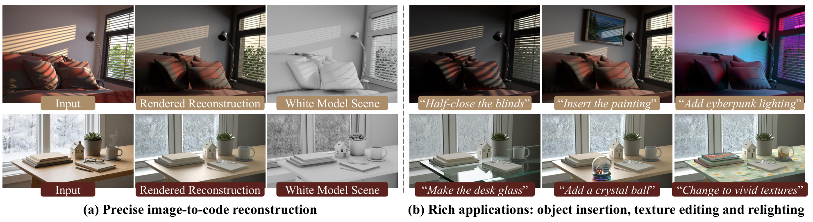
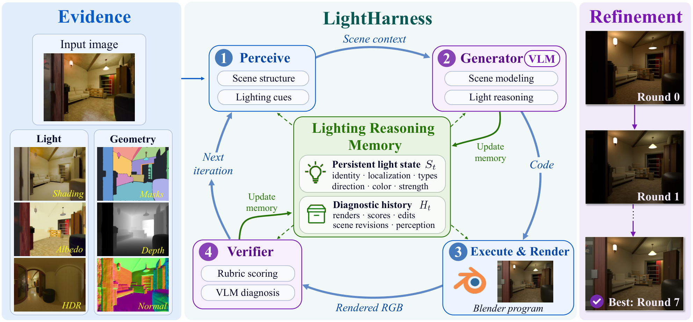
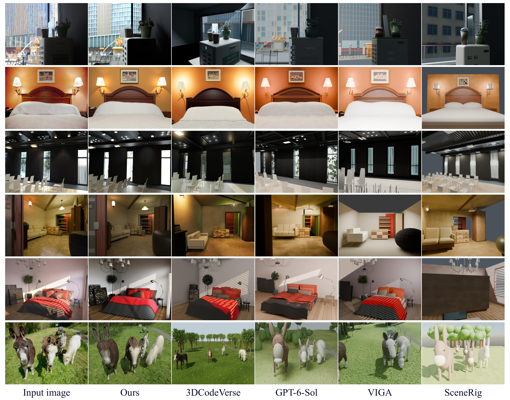
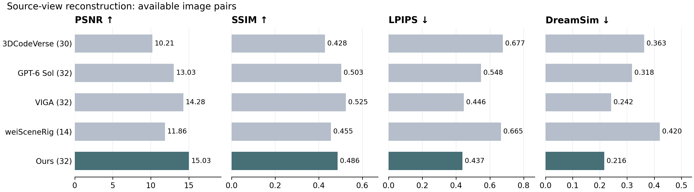

# LightHarness

**Beyond Appearance: Evidence-Guided Programmatic 3D Scene Reconstruction with Agentic Lighting Reasoning**

Author: [Zeting Luo](https://logic-al-al.github.io/), [Yifan Li](https://lyf1212.github.io/), [Shuai Yang](https://williamyang1991.github.io/)

LightHarness turns a single image into an editable Blender scene with new SOTA performance.

## 😎 Features

- An agentic looped system with generator-verifier framework.
- Lighting reasoning memory for explicit light source allocation.
- Enriched evidence with geometry, materials, and lights that both support the generator and rubric scorer.




## 🤖 Method Overview




## 🪄 Installation and Smoking Test

Use Linux, Python 3.11, and Blender 4.5.14. Put the Blender executable on `PATH`, or set its absolute path in a local configuration file. Run commands from the repository root.

```bash
python3.11 -m venv .venv
source .venv/bin/activate
python -m pip install -r requirements/dev.txt
cp configs/default.json config.local.json
# Edit config.local.json: set "blender" to your Blender executable.
python -m lightagent demo --run runs/demo
python -m pytest -q
```

The demo runs two iterations with real CPU rendering and synthetic evidence. It does not load vision models or call an API. Its expected selected round is `1` (round indices start at zero). Use a new output directory for each demo. The Blender regression test is skipped if the configured executable is unavailable.
We provide an example in `examples/simple_start`.

The rendering is written to that scene's `rerender/` directory. The original settings use OPTIX and 512 samples. For CPU rendering, change `device` to `CPU` in the scene's `settings.json`. This exported scene needs Blender only, and no model inference or API calls are involved.

## 🚩 Reconstruct an image

Install the four model environments and weights as described in [docs/models.md](docs/models.md). Edit `config.local.json` with the Python interpreters, model paths, and GPU assignments. Relative resource paths are resolved from the repository root. `${VARIABLE}` and `~` are supported in resource paths.

```bash
cp .env.example .env
# Fill OPENAI_API_KEY and OPENAI_BASE_URL in .env.
python -m lightagent doctor --output validation/environment.json
python -m lightagent reconstruct \
  --image /path/to/input.jpg --run runs/scene_001 --rounds 10
```

The used VLM model is `gpt-6-astra`, with `reasoning_effort=xhigh`. Your endpoint must accept this model and the configured Responses API. The project does not provide API access. Images and renderings are sent to the configured endpoint during a real reconstruction.

To resume a prepared run, use its saved configuration and increase the total iteration count if needed:

```bash
python -m lightagent run --run runs/scene_001 --rounds 10
```

`--rounds` is the total number of rounds. A run already at round 9 has completed 10 rounds. Outputs must stay inside this repository. Each run stores its configuration, evidence, accepted code, render passes, scores, and diagnostic history. `final/state.json` belongs to the selected scene, while the top-level `state.json` belongs to the latest round.

The vision workers stay loaded between requests. To release them:

```bash
python -m lightagent.resident status
python -m lightagent.resident stop
```

## 👀 Results




| Method | PSNR ↑ | SSIM ↑ | LPIPS ↓ | DreamSim ↓ |
| --- | ---: | ---: | ---: | ---: |
| 3DCodeVerse | 10.21 | 0.428 | 0.677 | 0.363 |
| GPT-6 Sol | 13.03 | 0.503 | 0.548 | 0.318 |
| VIGA | 14.28 | **0.525** | 0.446 | 0.242 |
| SceneRig | 11.86 | 0.455 | 0.665 | 0.420 |
| LightHarness (Ours) | **15.03** | 0.486 | **0.437** | **0.216** |




## ✅ Reproduce the results


We provide **all rendered results** of our method in `LightHarness_evaluation_images.zip` of [Google Drive](https://drive.google.com/file/d/1dtSqWObaxTega0OHtBYlZodHjKlyUEN-/view?usp=sharing), which contains the exact scored image pairs and the 32 original reconstruction inputs. Extract it in this repository to populate `results/images/` and `data/benchmark/`.

To rerun reconstruction on the original inputs, use the two recorded render profiles after configuring model paths and API access:

```bash
python -m lightagent --config config.local.json batch \
  --input configs/benchmark_512.json --run runs/benchmark_512
python -m lightagent --config configs/legacy_64.json batch \
  --input configs/benchmark_64.json --run runs/benchmark_64  
  # sample-64, maybe noisy in visualization due to Blender rendering.
```

Apply your model paths and API settings to both configurations. Batch parallelism defaults to 1. Add `--resume` to continue an interrupted batch. To use your own dataset copies instead of the image archive, try running with `scripts/prepare_benchmark.py --root /path/to/datasets`.

